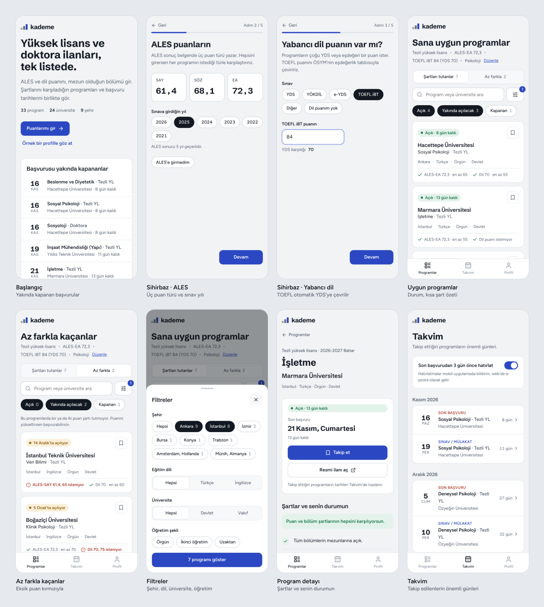

# Kademe

Yüksek lisans ve doktora ilanlarını tek listede toplayan web sitesi ve mobil uygulama. Öğrenci ALES, dil puanı, bölüm ve şehir tercihini girer; uygulama şartlarını karşıladığı programları ve başvuru tarihlerini gösterir. Eşleştirme tamamen kurallarla yapılır, yapay zeka veya ücretli API kullanılmaz.

("Kademe" çalışma adıdır.)



## Çalıştırma

```bash
npm install
npm run dev        # geliştirme sunucusu
npm test           # eşleştirme ve CSV testleri
npm run build      # dist/ (web sunucusu ve mobil uygulama için)
SINGLEFILE=1 npx vite build   # dist-onizleme/index.html (tek dosyalık önizleme)
```

## Klasörler

```
src/core/       Arayüzden bağımsız mantık (web ve mobil aynı kodu kullanır)
  types.ts        İlan ve öğrenci profili tipleri
  csv.ts          Dönem başı CSV'sini okur, satır satır doğrular
  eslestir.ts     Şart kontrolü: uygun / az farkla / elenen + başvuru durumu
  tarih.ts        Türkçe tarih biçimleri ("5 Ocak'ta", "21 Kasım, Cumartesi")
  sabitler.ts     Bölüm listesi, TOEFL→YDS tablosu (ÖSYM), ALES geçerlilik süresi
src/data/       Örnek ilanlar (gerçek ilan değildir)
src/app/        React arayüzü: ekranlar, bileşenler, durum
```

## Dönem başı veri girişi

1. Yönetim panelinde (`#yonetim`) "Şablonu kopyala" ile başlıkları al, Excel/Google E-Tablolar'a yapıştır.
2. Her satıra bir program gir. Tarihler `GG.AA.YYYY`, birden fazla bölüm `|` ile ayrılır.
3. CSV olarak kaydet, panele yükle. Hatalı satırlar Excel satır numarasıyla gösterilir; düzeltip yayınla.

Kabul edilen bölüm adları `src/core/sabitler.ts` içindeki listeden gelir; listede olmayan bir ad yazılırsa panel uyarır.
TOEFL→YDS tablosu ÖSYM'nin 11.03.2025 tarihli eşdeğerlik belgesinden alındı; her yıl kontrol edilmeli.

## Mobil uygulama

Aynı kod Capacitor ile iOS ve Android uygulamasına çevrilir:

```bash
npm i @capacitor/core @capacitor/cli @capacitor/android @capacitor/ios
npx cap init Kademe com.ornek.kademe --web-dir=dist
npm run build && npx cap add android && npx cap add ios
npx cap sync && npx cap open android   # iOS için Mac + Xcode gerekir
```

Son tarih hatırlatmaları için `@capacitor/local-notifications` eklenecek.

## Prototipte olmayanlar

- Profil, takip listesi ve yüklenen ilanlar şimdilik tarayıcıda (localStorage) tutuluyor. Canlı sürümde ilanlar sunucuda (ör. Supabase/Postgres), profil kullanıcı hesabında olacak.
- Yönetim panelinde giriş kontrolü yok.
- Hatırlatma ayarı kaydediliyor ama bildirim gönderilmiyor.
